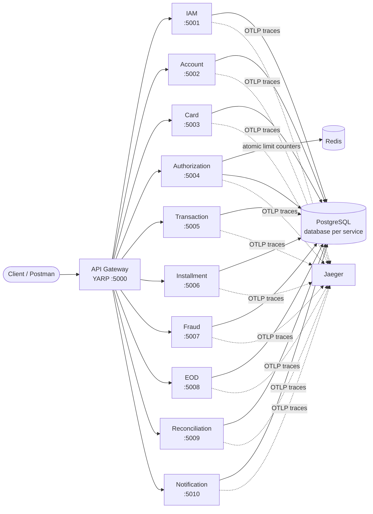

# MiniBank

[](https://github.com/Yusufislamyetkin/MiniBank/actions/workflows/ci.yml)


A card-payments backend built as a set of .NET 9 microservices: customer identity, accounts with a ledger, card issuing, real-time authorization, transactions, installments, fraud scoring, end-of-day processing, reconciliation and notifications — behind a single YARP API gateway.

It is a reference project modeled on the card-payments domain I worked in at a Turkish bank. The goal is to show how I structure a payments backend: clear service boundaries, rich domain models with explicit state machines, safe handling of card data, atomic spending limits and tests at both unit and integration level.

---

## Architecture



Every service follows the same layout:

```
MiniBank.<Name>Service/
├── Api/             controllers, DTOs, request validation
├── Application/     use-case logic (e.g. AuthorizationEngine, FraudScoringEngine)
├── Domain/          aggregates, value objects, state transitions, domain events
└── Infrastructure/  EF Core DbContext, migrations, repositories
```

Shared building blocks live in `src/Shared`: value objects (`Money`, `Pan`), domain enums, a base aggregate with domain events, a transactional outbox, a Redis cache service, JWT setup and OpenTelemetry wiring.

## Services

| Service | Port | What it does |
| --- | --- | --- |
| **IAM** | 5001 | Registration and login. Passwords hashed with **Argon2id**; short-lived JWT access tokens plus refresh tokens with rotation and revocation. |
| **Account** | 5002 | Checking, savings and credit accounts with an append-only **ledger**. Deposit, withdraw, freeze/unfreeze and close follow an explicit status machine (`Active ⇄ Frozen → Closed`). |
| **Card** | 5003 | Issues debit, credit and prepaid cards. The PAN is **Luhn-validated** and never stored in clear text — only a hash and a masked form. Card lifecycle `Created → Active → Blocked / StolenLost → Closed` and per-card limits (single, daily, weekly, monthly). |
| **Authorization** | 5004 | Real-time approve/decline decision: card status, expiry, balance, then daily and monthly limits enforced with **atomic Redis Lua scripts**, so two concurrent purchases cannot both slip past the limit. Supports reversals. |
| **Transaction** | 5005 | Purchase lifecycle: `Pending → Approved → Settled`, with reversal and refund paths. |
| **Installment** | 5006 | Splits a purchase into monthly installments with interest, tracks payments and cancellation. |
| **Fraud** | 5007 | Rule-based risk score (0–100) from amount, night-time activity, velocity, recent declines and cross-border use; opens fraud cases that can be investigated and resolved. |
| **EOD** | 5008 | End-of-day runs (`start → complete / fail`) and account statement generation. |
| **Reconciliation** | 5009 | Batches of card-network records matched against internal transactions; mismatches can be flagged and resolved. |
| **Notification** | 5010 | Multi-channel notification records with delivery tracking (`pending → sent → delivered / failed`). |
| **API Gateway** | 5000 | YARP reverse proxy routing `/api/<area>/**` to the right service. |

All service endpoints except login/registration require a JWT issued by IAM.

## Running locally

**Requirements:** Docker Desktop.

```bash
git clone https://github.com/Yusufislamyetkin/MiniBank.git
cd MiniBank/infra
cp .env.example .env
docker compose up --build
```

This starts PostgreSQL, Redis, Kafka, Jaeger, the 10 services and the gateway. Each service applies its EF Core migrations on startup.

| What | URL |
| --- | --- |
| API Gateway | http://localhost:5000 |
| Swagger UI (per service) | http://localhost:5001/swagger … http://localhost:5010/swagger |
| Jaeger (distributed traces) | http://localhost:16686 |

> The values in `.env.example` are development-only defaults. Use your own secrets for anything beyond a local demo.

### Try it

Each service folder contains a `.http` file you can run from Visual Studio, Rider or VS Code (REST Client). A typical flow through the gateway:

1. `POST /api/auth/register` then `POST /api/auth/login` → copy the access token
2. `POST /api/accounts` → create an account, then `POST /api/accounts/{id}/deposit`
3. `POST /api/cards` → issue a card for that account, then `POST /api/cards/{id}/activate`
4. `POST /api/authorizations` → authorize a purchase; repeat it to watch the daily limit decline the request
5. Open Jaeger and inspect the traces of those requests

## Tests

```bash
dotnet test
```

| Suite | Scope | Count |
| --- | --- | --- |
| Unit tests | Domain rules, state transitions, value objects, scoring and authorization logic (xUnit, FluentAssertions) | 158 |
| Integration tests | IAM and Account APIs end-to-end against a real PostgreSQL started by **Testcontainers** (`WebApplicationFactory`) | 14 |

Integration tests need Docker running. CI runs the build, both test suites and a Docker image build for every service on each push.

## Tech stack

- **.NET 9**, ASP.NET Core Web API, EF Core 9 (Npgsql)
- **PostgreSQL 16** — one database per service
- **Redis 7** — atomic limit counters (Lua) and caching
- **Kafka** (KRaft, in Docker Compose) + **MassTransit** packages — event-streaming infrastructure; outbox → Kafka publishing is the next roadmap item
- **YARP** — API gateway
- **OpenTelemetry + Jaeger** — distributed tracing
- **xUnit, FluentAssertions, Testcontainers** — testing
- **Docker Compose, GitHub Actions** — local stack and CI
- Central package management (`Directory.Packages.props`), shared build settings (`Directory.Build.props`)

## Design decisions

- **Database per service.** Each service owns its schema and migrations; no service reads another's tables.
- **Domain logic inside aggregates.** State changes go through methods such as `card.Block()` or `account.Withdraw()` that enforce allowed transitions and raise domain events, instead of setting status fields from controllers.
- **Atomic limits in Redis.** The authorization check increments the spend counter only if the new total stays under the limit, in a single Lua script, which removes the read-then-write race. If the monthly check fails, the daily increment is rolled back.
- **Card data handling.** Raw PANs never reach the database; the `Pan` value object validates, hashes and masks the number at the boundary.
- **Transactional outbox.** Domain events are written to an outbox table in the same transaction as the aggregate change, so an event is never lost when the database commit succeeds.

## Roadmap

These parts are designed but not finished yet:

- [ ] Publish outbox events to Kafka (the dispatcher currently only marks them as processed) and let services react to each other's events — e.g. Authorization → Transaction → Fraud.
- [ ] Replace the plain PAN hash with a keyed HMAC or a tokenization service.
- [ ] Idempotency keys on authorization and transaction endpoints.
- [ ] Integration tests for the remaining services.

## Project history

The original design documents (in Turkish) are kept in [`docs/design-notes-tr`](docs/design-notes-tr). They describe the target architecture, which is broader than what is implemented today.
