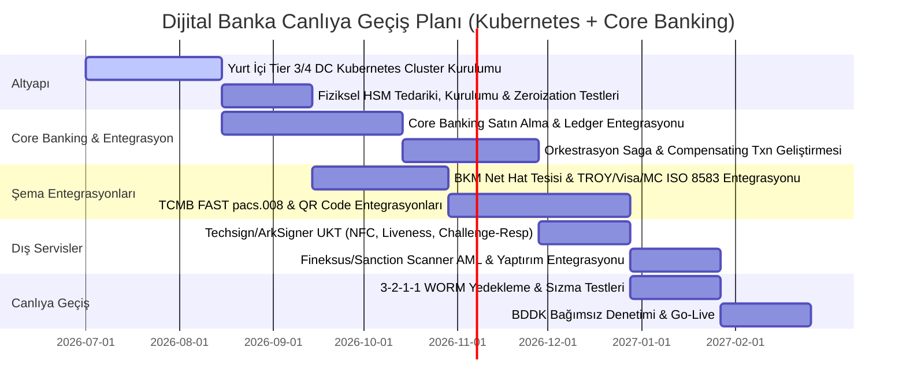

# Türkiye'de Gerçek Bir Banka İçin Üretim Ortamı (Production) Mimari Tasarım ve Regülatif Uyum Raporu

Bu rapor, projenin Türkiye Cumhuriyeti finansal düzenleyici kurumlarının (BDDK, TCMB, MASAK, KVKK) mevzuatlarına ve BKM (Bankalararası Kart Merkezi) standartlarına uygun hale getirilerek **bulut-agnostik standart Kubernetes** altyapısında, hazır bir **Çekirdek Bankacılık (Core Banking)** paketi ile entegre, **Visa, Mastercard, TROY** şemalarını içeren, dış sağlayıcı tabanlı **Video KYC (Uzaktan Kimlik Tespiti - UKT)** ve **AML/Sanctions** çözümleriyle yayına alınması için tasarlanmış nihai mimari başvuru kaynağıdır.

---

## 1. Altyapı Mimarisi: Standart Kubernetes (Bulut-Agnostik) ve HA Stratejisi

BDDK Bilgi Sistemleri Yönetmeliği uyarınca bankanın birincil ve ikincil sistemlerinin yurt içinde olması şarttır. Herhangi bir bulut sağlayıcı kilidine (vendor lock-in) girmemek adına, altyapı tamamen bulut-agnostik ve taşınabilir **standart Kubernetes** orkestrasyonu üzerinde kurulacaktır.

```
┌────────────────────────────────────────────────────────────────────────┐
│                        YURT İÇİ VERİ MERKEZLERİ                        │
│                                                                        │
│   ┌──────────────────────────────┐    ┌────────────────────────────┐   │
│   │ İSTANBUL VERİ MERKEZİ (Pri)  │    │  ANKARA VERİ MERKEZİ (DR)  │   │
│   │ (Tier 3/4, TS EN 50600 Cl.3) │    │  (Tier 3/4, TS EN 50600)   │   │
│   │                              │    │                            │   │
│   │  ┌────────────────────────┐  │    │  ┌──────────────────────┐  │   │
│   │  │ Standart Kubernetes    │  │    │  │ Standart Kubernetes  │  │   │
│   │  │ (Kritik Mikroservisler)│◄─┼───►│  │ (Warm Standby Pods)  │  │   │
│   │  └───────────┬────────────┘  │    │  └──────────┬───────────┘  │   │
│   │              │               │    │             │              │   │
│   │              ▼               │    │             ▼              │   │
│   │  ┌────────────────────────┐  │    │  ┌──────────────────────┐  │   │
│   │  │ PostgreSQL Enterprise  │  │    │  │ PostgreSQL Replica   │  │   │
│   │  │ (Patroni Active)       │◄─┼───►│  │ (Synchronous / Stand)│  │   │
│   │  └────────────────────────┘  │    │  └──────────────────────┘  │   │
│   └──────────────┬───────────────┘    └─────────────┬──────────────┘   │
│                  │                                  │                  │
│                  │          Dedicated Fiber         │                  │
│                  └──────────────────────────────────┘                  │
└────────────────────────────────────────────────────────────────────────┘
```

### Önemli Altyapı Kararları:
*   **Fiziksel Konum ve Sertifikasyon:** Birincil ve ikincil veri merkezleri Türkiye sınırları içinde, Kullanılabilirlik ve Koruma Sınıfı en az 3 olan **TSE TS EN 50600** operasyon belgesine veya Tier 3 / Tier 4 sertifikalarına sahip olmalıdır.
*   **Yurt İçi İzole Kesintisiz Çalışma:** Yurt dışı iletişim ağlarıyla bağlantıların tamamen kesildiği olağanüstü durumlarda dahi, birincil ve ikincil sistemler aracılığıyla ülke içerisindeki bankacılık faaliyetlerinin en geç **24 saat içinde kesintisiz** devam edebilmesi zorunludur.
*   **Ağ Gecikmesi ve Replikasyon:** İki veri merkezi arasında veri kaybı olmaksızın (RPO = 0) çalışabilmek için yarı-senkron/senkron replikasyon topolojisi kurulacaktır. Ağ ve düğüm bölünmelerine karşı 3. bir bölgede konumlandırılmış Witness node ile Quorum yapısı işletilecektir.

---

## 2. Çekirdek Bankacılık (Core Banking) ve Defter-i Kebir (Ledger) Mimarisi

Sistemde hazır bir Core Banking paketi (örn. **Architecht BOA** veya **Intertech inter-Beyond**) konumlandırılacaktır. Mikroservis katmanımız ile bu paket arasındaki Ledger entegrasyonu şu sarsılmaz muhasebe ilkelerine dayanmaktadır:

*   **Bakiye Karakteristiği (Asset vs. Liability):**
    *   Müşterilerin mevduat hesapları bankanın varlığı değil borcudur. Bu nedenle müşteri hesapları **Kredi Normal (Credit Normal - Liability)** hesaplardır.
    *   Bankanın kasasındaki nakit veya TCMB nezdindeki fonları ise **Borç Normal (Debit Normal - Asset)** varlık hesaplarıdır.
    *   Bir para yatırma işleminde bankanın nakit varlık hesabı borçlandırılırken (Debit), kullanıcının mevduat hesabı alacaklandırılır (Credit).
*   **Değiştirilemez Denetim İzi (Immutability):** Finansal kayıt tabloları kesinlikle **sadece eklenebilir (append-only)** olmalıdır. Eski kayıtların silinmesi (`DELETE`) veya güncellenmesi (`UPDATE`) sistem tarafından engellenmelidir. Hatalar ancak ters yönde bir telafi (reversal) kaydı atılarak düzeltilebilir.
*   **Fixed-Point Hesaplamalar:** Küsürat yuvarlama hatalarını engellemek için tüm parasal işlemler veritabanında en küçük birim olan **kuruş üzerinden tamsayı (integer)** veya yüksek hassasiyetli decimal formatında saklanır.
*   **Idempotency & Yüksek TPS:** Çift transferleri önlemek için her işlem benzersiz bir işlem kimliği (Transaction ID / Idempotency Key) ile korunur. Yüksek TPS gerektiren ledger operasyonları için **TigerBeetle** tarzı performans odaklı veritabanı motorları tercih edilebilir.

---

## 3. Dağıtık İşlem Yönetimi: Orkestrasyon Tabanlı Saga (Orchestration Saga)

Mikroservislerin kendi izole veritabanlarına sahip olduğu bu yapıda veri tutarlılığını sağlamak için **Saga Deseni (Saga Pattern)** kullanılacaktır.

*   **Orkestrasyon Tercihi:** Finansal işlemlerin yüksek tutarlılık gerektirmesi nedeniyle, asenkron koreografi yerine merkezi bir durum makinesini (State Machine) yöneten **Orkestrasyon Tabanlı Saga** kullanılacaktır.
*   **Tazmin Edici İşlemler (Compensating Transactions):** Dağıtık işlemin herhangi bir adımında başarısızlık yaşanırsa (örn. alıcının hesabına geçilememesi veya yetersiz bakiye), Saga Orchestrator önceki adımlarda yapılmış başarılı işlemleri tersine çevirecek tazmin edici adımları (geri ödeme/iade vb.) sırasıyla tetikler ve sistemi önceki tutarlı durumuna geri döndürür (Rollback).

---

## 4. Ödeme Sistemleri: BKM Switch ve TCMB FAST Entegrasyonları

### A. BKM Switch (ISO 8583) Entegrasyonu
BKM Switch altyapısı üzerinden akan kart provizyonlarında ISO 8583 finansal mesajlaşma protokolü soketler üzerinden işlenecektir:
*   `Field 2 (PAN)`: Kart Numarası.
*   `Field 3 (Processing Code)`: 6 haneli işlem yönlendirme kodu (örn. satın alma, bakiye sorma).
*   `Field 4 (Transaction Amount)`: Kuruş cinsinden noktasız 12 haneli sayısal veri (örn. 17.50 TL ➔ `000000001750`).
*   `Field 38 (Authorization ID Response)`: Otorizasyon onay kodu.

### B. TCMB FAST (ISO 20022) Entegrasyonu
Hesaptan hesaba anlık para transferi için ISO 20022 XML mesaj mimarisi entegre edilecektir:
*   **Mesaj Tipi:** Uçtan uca transferler için **`pacs.008` (FIToFICustomerCreditTransfer)** mesajı üretilecek ve çözümlenecektir.
*   **Teyit ve Sonuç:** FAST ağından gelen T01 (Teyit) ve T02 (Sonuç Bildirim) mesajları milisaniyeler içinde doğrulanıp işlenecektir.
*   **FAST Karekod (QR Code):** Karekod Akış Türü 01, 02 ve 03 kodlu dinamik karekodlar üretilecek ve okunduğunda kriptografik Hash doğrulamasıyla anlık FAST transferine dönüştürülecektir.

---

## 5. Açık Bankacılık (GEÇİT) ve Servis Modeli Bankacılığı (BaaS)

*   **TCMB GEÇİT (ÖHVPS):** BKM tarafından işletilen GEÇİT platformuna Hesap Bilgisi (HBHS) ve Ödeme Emri Başlatma (ÖBHS) entegrasyonu ÖHVPS API İlke ve Kurallarına göre yapılacaktır.
*   **Rıza Yönetimi (Consent Management):** Müşteriler, mobil ve web şube üzerinden Açık Bankacılık izinlerini istedikleri an görüntüleme ve rıza yetkisini "Açma/Kapama" hakkına sahip olacaktır.
*   **BaaS ve Multi-Tenancy:** Arayüz sağlayıcılar için izole edilmiş veri alanları ve rate-limiting kurgulanacaktır. Arayüz sağlayıcılarla yapılan her sözleşme ve değişiklik, yasal zorunluluk gereği **en geç bir hafta içinde** otomatik olarak BDDK raporlama sistemine iletilecektir.

---

## 6. Dijital Müşteri Edinimi: Uzaktan Kimlik Tespiti (UKT)

Müşteri edinimi, BDDK ve MASAK tebliğlerine uygun olarak mobil uygulama üzerinden şu adımlarla gerçekleştirilir:

1.  **Risk Skorlaması ve Ön Başvuru:** TCKN girişiyle başlar. MERNİS ve kara liste veritabanı anlık API sorgulamasıyla doğrulanır.
2.  **NFC ile Biyometrik Veri Okuma:** Yeni T.C. Kimlik Kartının çipi akıllı telefon NFC okuyucusuyla şifreli okunur. Biyometrik fotoğraf çipten doğrudan alınır. NFC'nin başarısız olması durumunda görsel doğrulama uygulanır ancak müşterinin ilk finansal işlemi başka bankadaki kendi hesabından EFT ile gelmelidir.
3.  **Canlılık Tespiti ve Görüntülü Görüşme:** Yapay zeka tabanlı "Canlılık Tespiti" (Liveness Detection - baş çevirme, göz kırpma) sonrası görüntülü görüşme uçtan uca şifreli (E2EE) olarak başlatılır. Görüşme kayıtları en az 10 yıl saklanır.
4.  **Asimetrik Kriptografik İmza (Challenge-Response):**
    *   Mobil uygulamadaki güvenli donanımda müşteriye özel asimetrik `Private Key` saklanır.
    *   Banka sunucusu, tek kullanımlık rastgele değer (Nonce) içeren bir "Challenge" gönderir.
    *   Mobil uygulama bunu Private Key ile imzalayıp "Response" olarak döner. Bu asimetrik şifreleme reddedilemezlik (non-repudiation) sağlar ve Replay-Attack riskini önler.

---

## 7. Kriptografik Güvenlik, Veri Mahremiyeti ve HSM

*   **Donanımsal Güvenlik (HSM):** FAST JSON Web Signature (JWS) işlemleri, Açık Bankacılık token imzalamaları ve veritabanı şifreleme anahtarları (DEK/KEK) FIPS 140-2 Level 3 sertifikalı fiziksel **HSM** (örn. Thales Luna) üzerinde saklanmalıdır. HSM, fiziksel müdahale algıladığında anahtarları anında yok etme (**zeroization**) yeteneğine sahip olmalıdır. API Gateway ile PKCS#11/JCE üzerinden entegre olacaktır.
*   **Sıfır Güven (Zero Trust) ve Ağ Segmentasyonu:** API Gateway giriş noktasında mTLS ve OAuth 2.0 doğrulamaları yapar. İç ağda mikro ağ segmentasyonu uygulanarak mikroservisler arası tüm veri akışları şifrelenir ve doğrulanır.
*   **Yedekleme ve WORM Storage:** Yedekler **3-2-1-1 yedekleme stratejisiyle**, yönetici (Admin) haklarıyla dahi silinmesi engellenen, donanımsal kilide sahip değiştirilemez **WORM (Write-Once-Read-Many)** depolama alanlarına aktarılacaktır.
*   **KVKK Uyum:** Sağlık ve cinsel hayata ilişkin hassas veriler asla yurt dışına veya yetkisiz yurt içi taraflara aktarılmaz. Loglarda veri maskeleme (log scrubber) uygulanır.

---

## 8. Revize Edilmiş Proje İş Haritası (Milestones)


